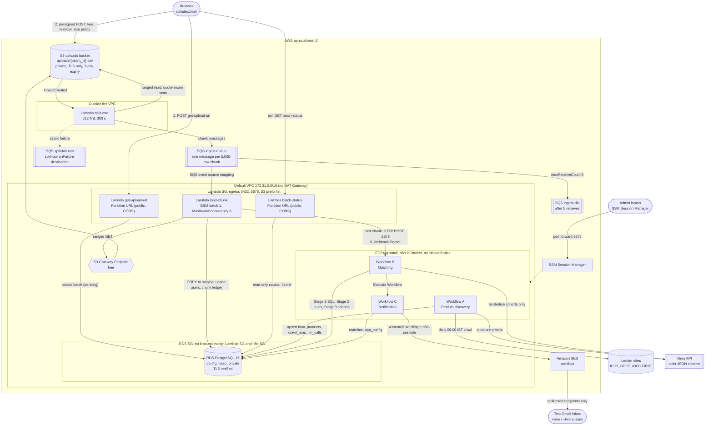

# Loan Eligibility Engine

Submission for the Clickpe.ai engineering-intern assignment.

An admin uploads a CSV of users in a browser. The file goes straight to S3, is split into 5,000-row chunks, and is loaded in parallel into a private PostgreSQL database by Lambda. When the last chunk lands, exactly one webhook starts an n8n pipeline that matches every user against loan products crawled from lender websites. A funnel of SQL, deterministic rules and a heavily cached LLM stage decides who is eligible. Matched users are emailed through SES, redirected to a test inbox only.

Everything below was run on a real AWS account (`ap-southeast-2`). Numbers come from real runs, and the command or task that produced each one is in [PROGRESS.md](PROGRESS.md). What is designed but not built is listed under [Limitations](#limitations).

| Measured on the 10,000-user sample CSV | Value |
|---|---|
| Upload → `processed` (2 chunks, 10,000 rows) | 6.9 s |
| Upload → `notified`, whole pipeline end to end | 41.5 s |
| User × product pairs | 30,000 |
| After the SQL pre-filter | 14,165 |
| Resolved by rules without an LLM | 11,944 (10,405 clear match + 1,539 clear reject) |
| Borderline pairs sent to the LLM stage | 2,221, as 20 cohorts, in 2 Groq calls (3,536 tokens) |
| Final matches | 11,841 for 6,017 users |
| Re-upload of the same file | 0 rows inserted, 0 updated, 0 LLM calls, 0 emails |

## Architecture

Full detail, private-versus-public table and the list of designed-but-not-built items: [docs/architecture.md](docs/architecture.md).



## Repo map

| Path | What it holds |
|---|---|
| [serverless.yml](serverless.yml) | The whole AWS ingestion stack: bucket, queues, four Lambdas, IAM roles, security group, S3 Gateway Endpoint |
| [lambdas/](lambdas) | `get_upload_url`, `split_csv`, `load_chunk`, `batch_status` (thin handlers) and `shared/` (pure, unit-tested logic) |
| [db/](db) | `schema.sql`, numbered migrations, `seed_products.sql`, the checksummed migration runner `migrate.py` |
| [n8n/](n8n) | `docker-compose.yml` and the exported workflows A, B and C |
| [ui/](ui) | One static page, no framework |
| [infra/](infra) | Step-by-step records and scripts for RDS, EC2, n8n, and the IAM policy documents |
| [scripts/](scripts) | `smoke_test.sh`, `retrigger_batch.sh`, `serve_ui.sh`, `verify_workflow_import.sh`, `check_package.py` |
| [tests/](tests) | Unit tests, PostgreSQL-backed integration tests, CSV fixtures |
| [docs/](docs) | `decisions.md` (every choice, the rejected option and the evidence), `architecture.md`, `data-notes.md`, `stage1-explain.md`, `rubric-evidence.md`, screenshots |
| [PROGRESS.md](PROGRESS.md) | Per-task log with commands and trimmed output for every number in this README |

## Prerequisites

- An AWS account and a CLI profile named `clickpe`. This account is locked by an organisation SCP to `ap-southeast-2`; the region is one value in `serverless.yml`.
- Three SES identities verified in that region: a Gmail address and its `+one` and `+two` aliases. SES stays in the sandbox, which is a second guard against mailing real users.
- A Groq API key.
- Local tools: Node.js 22, `uv`, Docker, `jq`, `curl`, Python 3.12.
- The sample `users.csv` in `data/`. The folder is gitignored because the file is personal data.

```bash
git clone <this repo> && cd loan-eligiblity-engine-clickpe
make install
```

## Deploy AWS

The account's default VPC is used, so no VPC is created. Replace the IDs in `serverless.yml` (`vpcId`, `subnetIds`, `mainRouteTableId`, `s3PrefixListId`) if you deploy to another account.

Secrets live in SSM Parameter Store as SecureStrings and are resolved at deploy time. Create them once. The database host and webhook URL are placeholders until RDS and EC2 exist:

```bash
export AWS_PROFILE=clickpe AWS_REGION=ap-southeast-2 AWS_PAGER=""
aws ssm put-parameter --name /clickpe/db/host --type String --value placeholder --overwrite
aws ssm put-parameter --name /clickpe/db/password --type SecureString --value "$(openssl rand -hex 24)" --no-overwrite
aws ssm put-parameter --name /clickpe/n8n/webhook_url --type String --value http://placeholder:5678/webhook/match-batch --overwrite
aws ssm put-parameter --name /clickpe/n8n/webhook_secret --type SecureString --value "$(openssl rand -hex 32)" --no-overwrite
```

1. **RDS.** Run the commands in [infra/rds.md](infra/rds.md). It creates a private `db.t4g.micro` PostgreSQL 16 instance and writes its endpoint to `/clickpe/db/host`.
2. **EC2 for n8n.** Launch the `t4g.small` instance with the commands under "Launch commands" in [infra/ec2.md](infra/ec2.md) (rebuilt from the live instance, not re-run), then run `infra/ec2/setup.sh` on it through SSM Run Command (the exact command is in that file). The instance has no inbound rules.
3. **Webhook URL.** Put the instance's private IP into `/clickpe/n8n/webhook_url`:

    ```bash
    aws ssm put-parameter --name /clickpe/n8n/webhook_url --type String --overwrite \
      --value http://<ec2-private-ip>:5678/webhook/match-batch
    ```

4. **Deploy the stack:**

    ```bash
    make package
    npx serverless deploy
    ```

5. **Open the database and n8n ports by security-group reference.** The three `authorize-security-group-ingress` commands (5432 from n8n and from the Lambda group, 5678 from the Lambda group) are at the end of "Launch commands" in [infra/ec2.md](infra/ec2.md).
6. **Migrate the schema from inside the VPC** with `infra/ec2/migrate.sh`, sent through SSM as described in [infra/ec2.md](infra/ec2.md). Running it twice applies 0 migrations the second time. The 5 seed products are flagged `is_seed` and labelled "Seed ·" in their names.
7. **Smoke test:**

    ```bash
    scripts/smoke_test.sh data/users.csv
    ```

   It calls the Function URLs, uploads with a presigned POST, polls until `processed`, and fails unless `rows_ok + rows_rejected` equals the CSV row count.

## Launch n8n and configure credentials

n8n runs as the exact image `docker.n8n.io/n8nio/n8n:2.44.4` from [n8n/docker-compose.yml](n8n/docker-compose.yml). The compose file is sent to the instance and started as shown in [infra/n8n.md](infra/n8n.md) ("Start / update"). The encryption key is generated on the instance and never leaves it.

Open the editor through an SSM port forward. There is no internet path to it:

```bash
aws ssm start-session --target <instance-id> --document-name AWS-StartPortForwardingSession \
  --parameters '{"portNumber":["5678"],"localPortNumber":["5678"]}'
```

Browse to `http://localhost:5678`, create the owner account and enable 2FA under Settings → Personal (this step is done in the browser). Then create four credentials by name, because workflows refer to the names only. Screenshots with values masked are in [docs/screenshots/](docs/screenshots).

| Credential | Type | Notes |
|---|---|---|
| `rds-postgres` | Postgres | RDS host from SSM, database and user `clickpe`, SSL Require, Ignore SSL Issues off. The container trusts the RDS CA through `NODE_EXTRA_CA_CERTS` |
| `aws-ses-assume-role` | AWS (Assume Role) | Use System Credentials on; role `clickpe-n8n-ses-role`. The EC2 instance role assumes an SES-only role, so there are no static AWS keys. Policies are in [infra/iam/](infra/iam) |
| `webhook-secret` | Header Auth | Header `X-Webhook-Secret`, value from SSM `/clickpe/n8n/webhook_secret` |
| `groq-api` | Header Auth | Header `Authorization`, value `Bearer <key>` |

## Import the workflows

The public API is off, so workflows are imported with the n8n CLI inside the container through SSM Run Command. The exact commands for import, publish and restart are in [infra/n8n.md](infra/n8n.md) ("Importing and running a workflow", "Publishing Workflow B", "Workflow C"). Order matters:

1. Import and publish Workflow C (`wfcnotification01`), because B calls it by id and a callee must be published.
2. Import and publish Workflow B (`wfbmatching001`), then restart n8n so the webhook is registered.
3. Import Workflow A (`wfaproductdisc01`). It runs daily at 06:00 IST, or on demand with `n8n execute`.

`docker exec n8n n8n list:workflow --active=true` must list B and C.

To prove the exported files load into a clean n8n without touching your instance:

```bash
scripts/verify_workflow_import.sh
```

## Run the demo

1. Run Workflow A once so `loan_products` holds real products, not only seed data.
2. Start the UI against the deployed Function URLs. This writes a local `ui/config.js` and serves `http://localhost:8000`, the only CORS origin:

    ```bash
    scripts/serve_ui.sh
    ```

3. Choose `data/users.csv`. The page checks the extension, size (20 MB) and header row, uploads with a progress bar, and shows the timeline `uploading → loading x/y chunks → processed → matching → matched → notified`, the row and reject counts, and the funnel with per-stage milliseconds.
4. Emails are not sent until `dry_run` is turned off in the database. Sending is capped by `max_emails_per_run` and every recipient is redirected to the three verified test inboxes:

    ```sql
    UPDATE app_config SET value = 'false' WHERE key = 'dry_run';
    UPDATE app_config SET value = 'true' WHERE key = 'dry_run';
    ```

    Run the first statement to send and the second to turn sending off again.
5. If n8n was down when a batch finished loading, the batch stays `processed`. Re-send the trigger with `scripts/retrigger_batch.sh <batch_id>`.

## Design decisions

Each choice, the option rejected and the evidence is in [docs/decisions.md](docs/decisions.md) (the decision log, with claims marked cited, measured or estimate). The ones a reviewer is most likely to ask about:

### Ingestion pattern

- **Presigned S3 POST, not a Lambda or API Gateway upload.** The browser uploads straight to S3, bypassing the 10 MB API Gateway and 6 MB Lambda payload limits. Only POST policies let S3 itself enforce the exact key, `text/csv` and a 1 B to 20 MB size range. Checked against real S3: valid file 204, 22 MB file `400 EntityTooLarge`, wrong type or key `403`.
- **S3 → `split-csv` → SQS → `load-chunk`.** The splitter walks the file with the same `csv.reader` the loader uses, so quoted newlines never break a chunk, and emits one message per 5,000 records with exact byte offsets. Each loader reads only its range, so a file's size is bounded by S3, not by one Lambda's timeout. Failed chunks retry individually and land in a DLQ after 5 receives.
- **COPY into a staging table, then one deduplicating upsert,** in one transaction per chunk. It compares data columns only, so re-uploading the identical file reports 0 inserted and 0 updated.
- **Concurrency is capped with the SQS event source mapping's `MaximumConcurrency: 3`.** Reserved concurrency is impossible here: AWS requires 100 unreserved units and this account's limit is 10 (measured). The cap also bounds RDS connections (`max_connections` is 79).
- **Exactly one trigger per batch.** Every chunk writes a `chunk_loads` ledger row in its own transaction. The invocation whose conditional `UPDATE … SET status='processed' WHERE status='loading' AND <ledger count> = total_chunks RETURNING id` gets a row back is the only one that calls n8n. Tested with 10 batches of 5 chunks delivered twice by 10 concurrent workers: exactly 10 POSTs. A mutation probe that weakens the guard gives 2 to 4 POSTs per batch.
- **Validation rejects, it does not stop.** Bad rows are stored in `rejected_rows` with the exact file line number and every broken field; good rows in the same file still load. A malformed fixture loaded 1 row and stored 10 rejects.

### No-NAT VPC design

A NAT Gateway and interface endpoints cost money for no benefit here. Lambdas that send to SQS (`split-csv`) run outside the VPC and never touch RDS. Lambdas that need RDS run inside the VPC and need no internet: S3 goes through the free Gateway Endpoint, SQS delivery to `load-chunk` is done by the Lambda service, and presigning is local signing. n8n sits in a public subnet with an outbound-only public IP, so it reaches Groq, the lender sites, SES and SSM through the free Internet Gateway while accepting nothing inbound.

### Crawling strategy

Three lenders are crawled with a plain GET from the n8n instance's own IP: ICICI, HDFC and IDFC FIRST. BankBazaar is a disabled spare. Each page's robots.txt was parsed per path and allows it. Every bank now redirects to a `bank.in` domain, so the site list stores final URLs. One CSS selector per site only narrows the page to the eligibility region; a text-anchored normaliser decides what counts as a criterion, and a redesign that breaks a selector produces `no_criteria_found` instead of a silent empty result. Kotak was rejected because its static HTML has no income, age or score criteria. Per-site failure branches mean one dead site never stops the others (drill: HDFC unreachable, ICICI and IDFC FIRST still upserted). Products are never deleted; after 3 consecutive failed crawls a product becomes inactive and is reactivated by the next good crawl.

### Optimization Treasure Hunt

The obvious design asks an LLM about every user and product pair. The measured Groq free-tier limits make that impossible: 30 requests a minute, 1,000 a day, 8,000 tokens a minute, 200,000 tokens a day, per model. For 10,000 users and 3 products that is 30,000 calls, which is 30 days of the daily quota for one upload.

So the engine spends tokens only on what columns cannot express:

1. **LLM at ingest, not at match time.** Workflow A structures a product's criteria once, with a strict JSON schema (`temperature 0`, `reasoning_effort low`).
2. **Stage 1, SQL.** One set-based `INSERT … SELECT` pairs users and active products on the hard criteria (NULL means no limit) and keeps near misses within 5% of an income or score threshold. Pairs stay in Postgres.
3. **Stage 2, rules.** An indicative EMI check (₹5,00,000 over 60 months at the published rate, capped at 65% of income, a figure BankBazaar publishes) and a classifier set in SQL: `clear_match`, `clear_reject` or `borderline`. Products with `parse_confidence` of at least 0.70 resolve borderline pairs without an LLM.
4. **Stage 3, cohorts.** Borderline pairs are grouped by product, borderline reason, employment and a coarse band of the triggering feature, not by raw values, which would give 1,028 to 5,528 cohorts per product on this data (measured). One strict-schema request per product.
5. **Cache.** `cohort_verdicts` is keyed by cohort and the product's content hash, so a product change invalidates its verdicts and a re-upload costs zero calls.
6. **Budget guard.** Pairs left when the token or call budget is spent are recorded as `unresolved_budget`, never guessed.

Measured on the real CSV. Counts and tokens are from the end-to-end run (Workflow B execution 94); stage times are from the T33 to T36 runs on RDS:

| Stage | Result |
|---|---|
| All pairs (10,000 users × 3 active products) | 30,000 |
| Stage 1 SQL | 14,165 candidates (10,405 strict, 3,760 near miss), 578 ms |
| Stage 2 rules | 10,405 clear match, 1,539 clear reject, 2,221 borderline, 625 ms |
| Stage 3 cohorts | 2,221 pairs → 20 cohorts → 2 Groq calls, 3,536 tokens |
| Verdicts | 1,436 eligible, 785 not eligible |
| Final | 11,841 matches for 6,017 users |
| Same batch again | 0 inserted, 0 LLM calls, 20 of 20 cohort cache hits |

Per-pair asking would be 2,221 calls for the borderline pairs alone. Per-stage timings are stored in `pipeline_runs.stage_ms` and shown in the UI. Finding a stale planner statistic that made cohort forming take 16 s, and adding an `ANALYZE` node that brought it to 168 ms, is in [docs/decisions.md](docs/decisions.md) → "Workflow B Stage 3".

A benchmark at 100,000 rows (T37) has not been run. No scale figure beyond the 10,000-row sample is claimed.

## Security

- **Upload.** Presigned POST pinned to one key, content type and size range, valid 5 minutes. The bucket blocks all public access, enforces TLS and expires uploads after 7 days.
- **Database.** RDS is not publicly accessible; public DNS resolves only to a private address, and a laptop gets `No route to host`. `rds.force_ssl` is on, `sslmode=disable` is rejected, and clients verify the RDS CA (`verify-full`). Port 5432 is open to the Lambda and n8n security groups by reference only.
- **n8n.** The security group has zero inbound rules from the internet. The editor is reachable only through an SSM Session Manager port forward, with an owner account. 2FA was turned on by the user in the browser; no screenshot of it was captured. Port 5678 accepts the webhook from the Lambda security group alone.
- **Webhook, four layers.** Security group, n8n IP allowlist (VPC CIDR), Header Auth secret, and a claim that refuses unless the batch is `processed` (a replay gets 409).
- **IAM.** One role per Lambda, no wildcard actions. The only `*` resource is the three network-interface actions every VPC Lambda requires. The EC2 instance role assumes an SES-only role limited to three verified identities, so there are no static AWS keys.
- **Email safety.** Every recipient is redirected to the verified test aliases, a guard node re-reads the allowed list and throws on any other recipient, any cc, bcc or reply-to, or more messages than the cap. The guard blocked a deliberately wrong address in a drill, and SES would refuse unverified identities anyway.
- **Secrets.** SSM SecureStrings, resolved at deploy. They are also present as literals in the deployed CloudFormation template, which is documented in `docs/decisions.md` → "Secrets".
- **Public by design.** The `get-upload-url` and `batch-status` Function URLs are `AuthType NONE`, because the browser has no AWS credentials. CORS is pinned to the UI origin, `lambda:InvokeFunction` requires `InvokedViaFunctionUrl`, and the upload is bounded by the POST policy. API Gateway with auth and throttling is the production upgrade.
- **Known issue.** n8n stores the incoming `X-Webhook-Secret` header in saved Workflow B execution data (found in the T43 drills). Executions are pruned after 168 hours; rotate the secret after the demo. The formal security review (T45) has not been run.

## Cost

No NAT Gateway, no Multi-AZ, no provisioned IOPS, no interface VPC endpoints, and nothing larger than `t4g.small`. The resources are: one `db.t4g.micro` with 20 GB gp3, one `t4g.small` with a 20 GB volume, four Lambdas on arm64, one S3 bucket with a 7-day lifecycle, three SQS queues, and SES in the sandbox. Groq is used on its free tier. A priced cost table for the demo and for 1M users a month (T46) has not been written, so no dollar figures are claimed here.

## Testing

```bash
make check
```

runs `ruff check`, `ruff format --check`, `mypy` (strict) and `pytest` with an 80% branch-coverage floor on `lambdas/shared`.

Tests that need PostgreSQL create a throwaway database per test and are skipped without a server:

```bash
docker run -d --rm --name pg -e POSTGRES_PASSWORD=test -p 55432:5432 postgres:16
TEST_DB_HOST=127.0.0.1 TEST_DB_PORT=55432 TEST_DB_PASSWORD=test make check
```

Result of the last run: `All checks passed!`, `80 files already formatted`, `Success: no issues found in 65 source files`, **`506 passed`** and **100.00% coverage** of `lambdas/shared`. Without a database, `329 passed, 177 skipped` and 99.82%.

The SQL and Code nodes inside the exported workflows are tested where they live: the exported SQL runs on PostgreSQL 16 and the exported Code nodes run under Node.js inside pytest. Mutation probes (weakening a guard on purpose) were run for the critical paths, and each one failed at least one test.

## Limitations

Stated plainly, because these are known:

- **Designed, not implemented:** Workflow E (global error handler, T25), the reusable Groq "LLM Gateway" sub-workflow (T26, so Workflows A and B call Groq with their own HTTP Request nodes), crawl change detection (T29, so Workflow A calls Groq for every site each run), the CloudWatch alarm on the DLQ (T21), the 100,000-row benchmark (T37), the cost table (T46), and the security review (T45). Workflows A, B and C therefore have no Error Workflow set.
- **UI polish (T41) is built and tested locally but not deployed.** The deployed `batch-status` does not yet return the grouped reject report or the CSV download.
- **Demo data.** The 5 seed products are fake and labelled so. Only three lenders are crawled. A lender's published rate is missing for ICICI and HDFC, so their rows have a lower `parse_confidence` and an EMI check of "not checked".
- **Matches are indicative.** The eligibility rules use public criteria text and stated assumptions; they are not a credit decision.
- **Sandbox email.** SES is in the sandbox and the test emails landed in Spam in the Gmail inbox (screenshot in `docs/screenshots/`); the likely cause is missing DKIM on the sender and the fix is documented.
- **Single region.** The account is SCP-locked to `ap-southeast-2`. The production target would be `ap-south-1` for latency and RBI data localisation.
- **Scale measured only to 10,000 users.** The design is chunked and bounded, but nothing larger has been run.

## Future work

- Finish the designed items above, starting with the LLM Gateway and Workflow E.
- API Gateway with authentication and throttling in front of the Function URLs.
- A transactional outbox for the n8n trigger instead of the documented retrigger script.
- Multi-AZ RDS, Secrets Manager with rotation, and DKIM on a verified domain for SES production access.
- Step Functions Inline Map for fan-out, the runner-up considered in `docs/decisions.md`.
