# loan-eligiblity-engine-clickpe
This is the submission for the assignement provided by Clickpe.ai team part of their intern recruitement process.

## Architecture

Full detail, private/public table and the list of designed-but-not-built items: [docs/architecture.md](docs/architecture.md).

```mermaid
flowchart TB
    user(["Browser<br/>ui/index.html"])
    lenders[("Lender sites<br/>ICICI, HDFC, IDFC FIRST")]
    groq[["Groq API<br/>strict JSON schema"]]
    inbox(["Test Gmail inbox<br/>+one / +two aliases"])
    admin(["Admin laptop<br/>SSM Session Manager"])

    subgraph aws["AWS ap-southeast-2"]
        direction TB

        subgraph pub["Outside the VPC"]
            split["Lambda split-csv<br/>512 MB, 300 s"]
        end

        s3[("S3 uploads bucket<br/>uploads/{batch_id}.csv<br/>private, TLS only, 7-day expiry")]
        q[["SQS ingest-queue<br/>one message per 5,000-row chunk"]]
        dlq[["SQS ingest-dlq<br/>after 5 receives"]]
        sf[["SQS split-failures<br/>split-csv onFailure destination"]]
        ses["Amazon SES<br/>sandbox"]
        ssm["SSM Session Manager"]

        subgraph vpc["Default VPC 172.31.0.0/16 (no NAT Gateway)"]
            direction TB
            s3gw{{"S3 Gateway Endpoint<br/>free"}}

            subgraph lsg["Lambda SG: egress 5432, 5678, S3 prefix list"]
                load["Lambda load-chunk<br/>ESM batch 1, MaximumConcurrency 3"]
                getUrl["Lambda get-upload-url<br/>Function URL (public, CORS)"]
                status["Lambda batch-status<br/>Function URL (public, CORS)"]
            end

            subgraph rdsg["RDS SG: no inbound except Lambda SG and n8n SG"]
                rds[("RDS PostgreSQL 16<br/>db.t4g.micro, private<br/>TLS verified")]
            end

            subgraph ec2["EC2 t4g.small, n8n in Docker, no inbound rules"]
                direction TB
                wfA["Workflow A<br/>Product discovery"]
                wfB["Workflow B<br/>Matching"]
                wfC["Workflow C<br/>Notification"]
            end
        end
    end

    user -- "1. POST get-upload-url" --> getUrl
    getUrl -- "create batch (pending)" --> rds
    user -- "2. presigned POST: key, text/csv, size policy" --> s3
    s3 -- "ObjectCreated" --> split
    split -- "ranged read, quote-aware scan" --> s3
    split -- "chunk messages" --> q
    split -. "async failure" .-> sf
    q -- "SQS event source mapping" --> load
    q -- "maxReceiveCount 5" --> dlq
    load -- "ranged GET" --> s3gw
    s3gw --> s3
    load -- "COPY to staging, upsert users, chunk ledger" --> rds
    load -- "last chunk: HTTP POST :5678<br/>X-Webhook-Secret" --> wfB
    user -- "poll GET batch-status" --> status
    status -- "read-only counts, funnel" --> rds

    wfA -- "daily 06:00 IST crawl" --> lenders
    wfA -- "structure criteria" --> groq
    wfA -- "upsert loan_products, crawl_runs, llm_calls" --> rds
    wfB -- "Stage 1 SQL, Stage 2 rules, Stage 3 cohorts" --> rds
    wfB -- "borderline cohorts only" --> groq
    wfB -- "Execute Workflow" --> wfC
    wfC -- "matches, app_config" --> rds
    wfC -- "AssumeRole clickpe-n8n-ses-role" --> ses
    ses -- "redirected recipients only" --> inbox
    admin -- "port forward 5678" --> ssm
    ssm -.-> ec2
```

