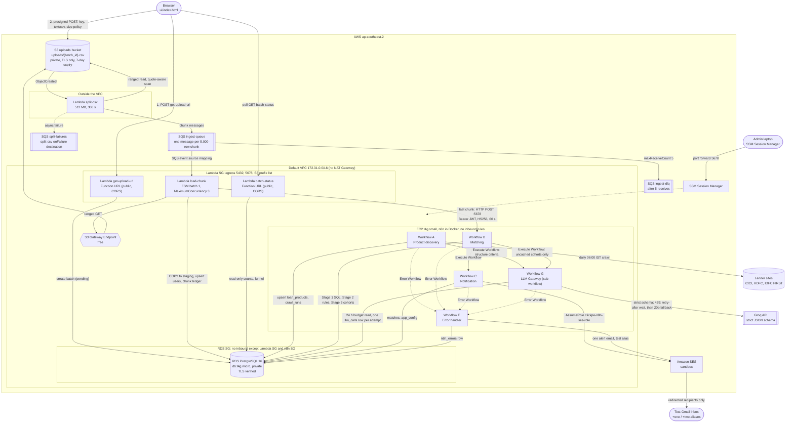

# Architecture

Region `ap-southeast-2`, stack `clickpe-loan-engine`, default VPC `vpc-0cddb8b4387b5bbdc` (`172.31.0.0/16`).
Every box below exists in `serverless.yml`, `infra/` or `n8n/workflows/`; items not built are drawn dashed and
listed under "Designed, not implemented".

## System diagram

## Private versus public

| Component | Reachable from the internet? | Control |
|---|---|---|
| S3 bucket | No (public access blocked, TLS-only policy); upload only through a 5-minute presigned POST | Exact key, `text/csv`, `content-length-range` 1 B to 20 MB |
| `get-upload-url`, `batch-status` Function URLs | Yes, `AuthType NONE`, CORS pinned to the UI origin | Documented as public; production upgrade is API Gateway with auth and throttling |
| `split-csv`, `load-chunk` | No URL; invoked by S3 and SQS only | Resource policy for S3, event source mapping for SQS |
| RDS | No (private address only, `PubliclyAccessible false`) | SG allows 5432 from the Lambda SG and n8n SG only; `rds.force_ssl` on, `verify-full` from clients |
| n8n webhook `:5678` | No | SG allows it from the Lambda SG only; VPC-CIDR allowlist; HS256 JWT signed per call (60 s, names the batch); Workflow B refuses unless the batch is `processed` |
| n8n editor | No (zero inbound rules) | SSM Session Manager port forward to `localhost:5678` |

## Why there is no NAT Gateway

- Lambdas that send to SQS (`split-csv`) run outside the VPC and never touch RDS.
- Lambdas that need RDS (`load-chunk`, `get-upload-url`, `batch-status`) run inside the VPC and need no internet:
  S3 goes through the free Gateway Endpoint, SQS delivery to `load-chunk` is done by the Lambda service, and
  presigning is local signing.
- n8n sits in a public subnet with an outbound-only public IP, so it reaches Groq, the lender sites, SES and SSM
  through the free Internet Gateway while accepting nothing inbound.

## Data flow, one batch

1. UI calls `get-upload-url`; the batch row is `pending`.
2. UI uploads straight to S3; `ObjectCreated` triggers `split-csv`, which emits one SQS message per 5,000-row chunk
   with exact byte offsets and `total_chunks`.
3. `load-chunk` (at most 3 concurrent) writes a `chunk_loads` ledger row, validates, COPYs into a temporary staging
   table and upserts `users` in one transaction. A redelivered chunk finds its ledger row and exits.
4. The invocation whose conditional `loading → processed` UPDATE returns a row POSTs `{batch_id}` to Workflow B,
   exactly once per batch.
5. Workflow A, on its own daily schedule, compares each lender page's criteria hash with `loan_products.content_hash`
   and calls Groq (through the LLM Gateway) only for pages that changed.
   Workflow B: Stage 1 SQL pre-filter, Stage 2 deterministic rules, Stage 3 cohort verdicts (cache first, Groq for
   misses only, through the LLM Gateway), then inserts `matches`, finalizes `pipeline_runs` and calls Workflow C.
6. Workflow C composes emails, redirects every recipient to `TEST_INBOX_ALIASES`, aborts if any recipient is outside
   that list, then sends through SES unless `dry_run` is true, and marks `notified_at`.
7. If A, B, C or the LLM Gateway fails an automatic execution, n8n starts Workflow E, which stores an `n8n_errors` row and sends one
   alert email to the first test alias.

## Designed, not implemented

These are not in the deployed system and are drawn nowhere above.

| Item | Task | State |
|---|---|---|
| CloudWatch alarm on `ingest-dlq` depth | T21 | Built and drilled: alarm, batch marked `failed` on the 5th receive, `scripts/redrive_dlq.sh` |
| Transactional outbox for the n8n trigger | n/a | Production upgrade; `scripts/retrigger_batch.sh` is the recovery path |
| API Gateway in front of the Function URLs, Multi-AZ RDS, Secrets Manager | n/a | Production upgrades only |
